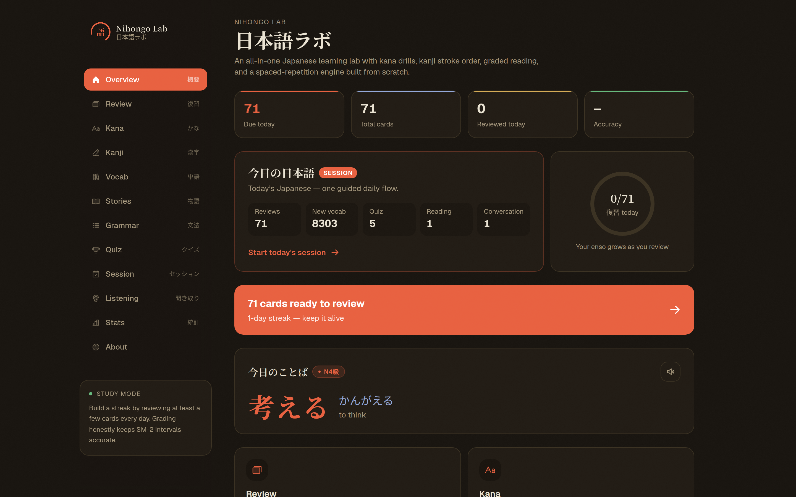
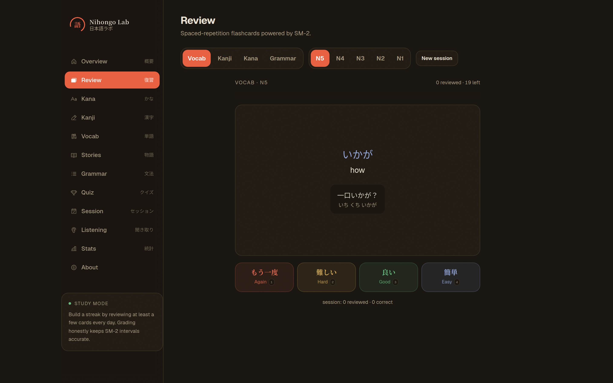
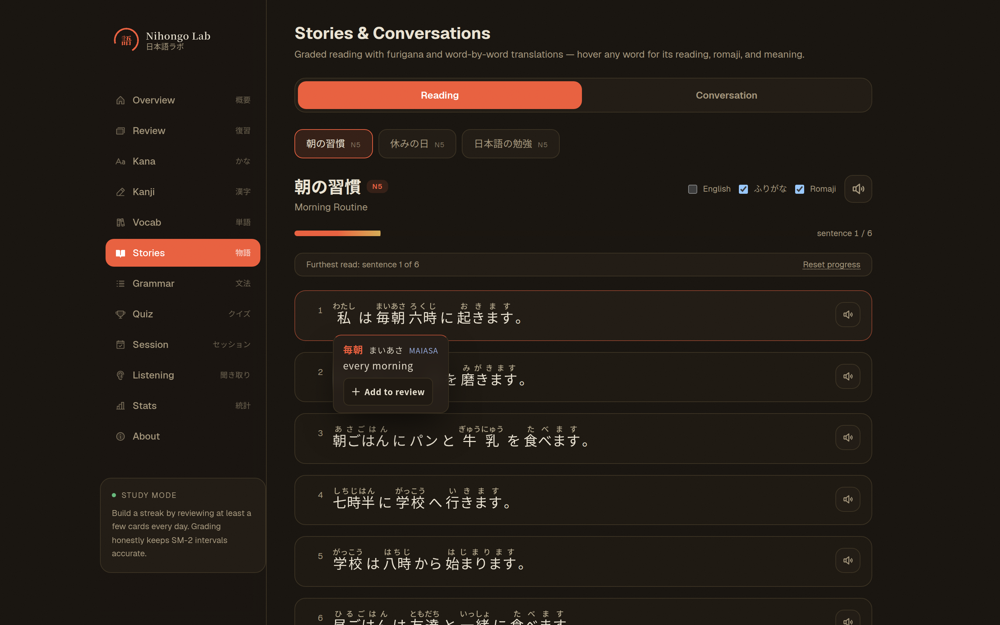
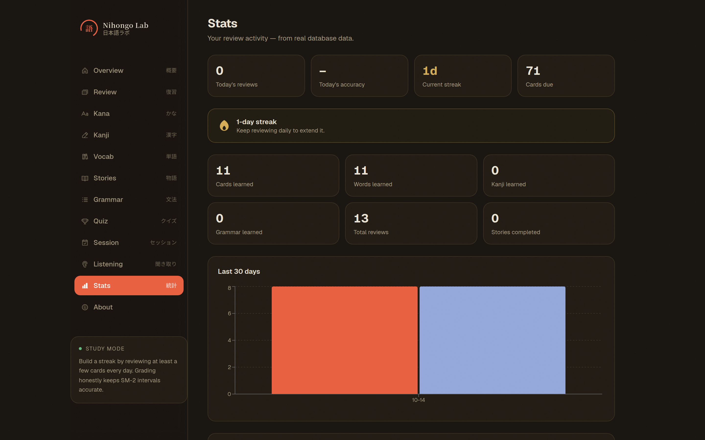

# Nihongo Lab 日本語ラボ

An all-in-one Japanese learning lab for serious self-study — kana drills, JLPT kanji with
animated stroke order, an 8,000+ word vocabulary deck, grammar patterns, **graded reading
stories with word-by-word furigana**, interactive conversation practice, quizzes, listening,
and a spaced-repetition review engine built on a from-scratch SM-2 implementation.

Built with real infrastructure in mind: a Prisma-backed SQLite database, a custom
morphology-light tokenizer, a kana→romaji converter, and a fully unit-tested SRS scheduler.
Offline-first by design — no cloud NLP, no API-key services, no external speech synthesis.

| | |
|---|---|
| **8,334** vocabulary words (N5–N1) | **2,211** JLPT kanji with stroke order |
| **100** grammar points | **92** kana with recognition drills |
| **3** graded stories + **2** conversations | **73** passing tests (Vitest) |

---

## Screenshots

| Overview | Review |
|:---:|:---:|
|  |  |
| **Stories** | **Stats** |
|  |  |

Dark sumi theme throughout. The stories screenshot shows the hover tooltip — kanji form,
kana reading, romaji, meaning, and a one-click **Add to review** button.

---

## Features

### 📖 Reading & Conversation *(the headline module)*
- **Graded stories** (N5) with per-word **furigana** rendered inline as ruby text.
- **Hover any word** for an instant tooltip: kanji form, kana reading, **romaji**, and the
  English meaning — no dictionary lookup required. Push any word straight into the review
  queue from the tooltip.
- **Conversation practice**: play the learner in a scripted café ordering / self-introduction
  dialogue. Pick your line from three natural options, get instant correct/incorrect feedback
  with an explanation, and build a scored transcript you can replay with TTS audio.
- Every story line and conversation turn has **native Japanese TTS** (browser Web Speech API,
  no API key); transcripts can be replayed as a reliable line-by-line sequence.

### 🗂 Review — SM-2 spaced repetition
- Flashcards for **vocab / kanji / kana / grammar** at any JLPT level.
- A from-scratch **SM-2 scheduler** (`src/lib/srs.ts`) with ease factor, interval growth,
  lapses, and a due-date queue — fully unit tested.
- Grade `again / hard / good / easy`; new cards are auto-created from the datasets on demand.
- Cards carry example sentences; vocab example sentences get an auto-generated **furigana line**.

### 🔤 Kana
- Hiragana & katakana charts with romaji, plus a recognition drill with audio.

### 漢字 Kanji
- Browse all JLPT N5–N1 kanji with on/kun readings and English meanings.
- **Animated stroke order** rendered from KanjiVG SVG data.
- **Canvas draw-practice mode** with a ghosted guide overlay.

### 単語 Vocab
- 8,000+ JLPT words (N5–N1) with readings, meanings, and TTS.
- Kanji words display **inline furigana**.

### 文法 Grammar
- JLPT grammar points with meaning, formation rules, and example sentences.

### 🎯 Quiz
- Server-generated multiple-choice quizzes with meaningful distractor options
  (deduplicated, exactly one correct answer) — seeded generation is
  reproducible via `?seed=`.
- Balanced question directions: vocab J→E / E→J, kanji → meaning / → reading.

### 🎧 Listening
- A TTS listening quiz: hear a sentence and pick the one you heard, with
  replay, slow playback, and per-round scoring.
- Distractors are ranked by shared vocabulary with the target sentence, so
  options differ in content while matching the same grammar shape.

### 📅 Daily session
- 「今日の日本語」 — one guided daily flow: review → new vocabulary →
  reading → quiz → conversation → daily result, at your chosen JLPT level.

### 📊 Stats
- Today's reviews/accuracy/streak, cards due and learned (words, kanji,
  grammar), total reviews, stories completed — all real data from the database.
- Learning-over-time chart from daily history, and **progress by JLPT
  level** computed against the actual curriculum size.

### 🏷 About & data
- Dedicated attribution page (`/about`): sources, licenses, bundle update
  dates for OpenJLPT/JMdict/KANJIDIC2/Tatoeba/KanjiVG.

---

## Architecture

```text
Browser (client components)
  │  fetch /api/*            │  server-rendered HTML
  ▼                          ▼
Next.js App Router ──── route handlers (src/app/api/*)
  │                            │
  │  src/lib/datasets.ts       │  Prisma (SQLite via better-sqlite3 driver adapter)
  │  (react cache, server)     │  Card / ReviewLog / DayStat
  ▼                            ▼
data/*.json ─────────── dev.db (git-ignored; DATABASE_URL override supported)
  (bundled snapshots)
```

- **Server components** load and tokenize datasets (stories, vocab, kanji, grammar) and
  stream ready-to-render HTML — the large JSON files never cross the wire.
- **Client components** own all interactivity: flashcards, quizzes, tooltips, drawing canvas,
  TTS playback, session flow.
- **API routes** are the only code that touches Prisma. Validation happens at the boundary;
  routes never leak stack traces or internal errors.

Full decision records live in **[docs/ARCHITECTURE.md](docs/ARCHITECTURE.md)**.

---

## Tech stack

| Layer | Choice |
|---|---|
| Framework | Next.js 16 (App Router, Turbopack) · React 19 · TypeScript |
| Styling | Tailwind CSS v4 (CSS-first config) |
| Motion | Framer Motion |
| Icons | Phosphor Icons (`@phosphor-icons/react`) |
| DB / ORM | Prisma 7 + SQLite via `@prisma/adapter-better-sqlite3` |
| Charts | Recharts |
| Tests | Vitest |
| TTS | Web Speech API (`speechSynthesis`, Japanese voice, sequenced line playback) |
| Data | Bundled JSON from OpenJLPT / KanjiVG (see Licensing) |

---

## Project structure

```
data/                        Bundled dataset JSON (vocab/kanji/grammar per level, kana, stories, conversations)
prisma/
  schema.prisma              Card / ReviewLog / DayStat models
src/
  lib/
    srs.ts                   SM-2 scheduler (pure, unit-tested) — the review core
    review-service.ts        Queue building + review submission (creates cards, updates stats)
    tokenizer.ts             Japanese word segmentation (longest-match + overrides + particles + kanji fallback)
    romaji.ts                kana → romaji converter
    datasets.ts              Server-only dataset loaders (node:fs, React cache)
    levels.ts                Client-safe JLPT level constants
    tts.ts                   Web Speech API helper
    db.ts                    Prisma client (DATABASE_URL-aware)
    api.ts                   Client fetch helpers
  app/
    api/
      review/queue           GET  — due + new review queue for a type/level (backfills missing cards)
      review                 POST — grade a card (SM-2 update + stats)
      quiz                   GET  — multiple-choice questions with distractors
      listening              GET  — listening quiz (sentences + options + tokens)
      cards                  POST — ensure a card exists (add-to-review)
      session/newwords       GET  — unseen vocab words for the daily session (?seed= supported)
      stats                  GET  — dashboard aggregate + history
    review/ kana/ kanji/ vocab/ grammar/ quiz/ listening/ session/ stats/ stories/ about/   UI pages
  components/                Client components (FlashcardReview, KanjiDraw, StoryReader, Session, …)
  components/ui/             Shared UI primitives (Button, Modal, SegmentedControl, SpeakButton, …)
  proxy.ts                   Optional x-api-token gate for mutating POSTs (Next 16 Proxy)
  lib/random.ts              Seeded PRNG for deterministic generation
  lib/dates.ts               Local-timezone day keys + streak computation
```

---

## Getting started

```bash
npm install
npx prisma generate          # generate the Prisma client (src/generated)
npx prisma migrate dev       # create + apply the SQLite schema
npm run dev                  # http://localhost:3000
```

> The SQLite database file is created at the project root (`dev.db`) and is git-ignored.
> Override its location with `DATABASE_URL=file:/path/to.db` (read by `src/lib/db.ts` and
> `prisma.config.ts`). Prisma 7 uses a driver adapter, so the URL lives there rather
> than in `.env`.

### Scripts

```bash
npm run dev            # development server (Turbopack)
npm run build          # production build + typecheck
npm run start          # serve the production build
npm run lint           # ESLint (Next.js + react-hooks v6 rules)
npm test               # Vitest unit tests
npm run datasets:check # validate bundled datasets + report update dates
```

---

## Testing

**73 tests across 6 files**, all green:

| Suite | Tests | Covers |
|---|---|---|
| `srs` | 17 | SM-2 ease/interval/lapse math, grade mapping, floor clamps |
| `api` | 23 | Route validation, seeded-deterministic quiz/listening generation, duplicate-option invariants |
| `tokenizer` | 16 | Longest-match segmentation, override dictionary, particles, kanji fallback |
| `romaji` | 8 | Long vowels, gemination, yō-on, katakana input |
| `proxy` | 5 | `x-api-token` gate behavior with/without `API_TOKEN` |
| `review-service` | 4 | Queue → grade → log → day-stat integration against real SQLite |

```bash
npm test               # Vitest
npm run lint           # ESLint — must pass with zero errors
npx tsc --noEmit       # TypeScript — must pass
npm run build          # production build — must pass
```

API tests use the real SQLite database and clean up after themselves. See
[CONTRIBUTING.md](CONTRIBUTING.md) for conventions and the full workflow.

---

## Engineering decisions

Why things are the way they are (deep dives in [docs/ARCHITECTURE.md](docs/ARCHITECTURE.md)):

- **Custom tokenizer** — offline-first means no MeCab/Kuromoji. A deterministic pipeline:
  a curated override dictionary of inflected forms → longest-match vocabulary lookup against
  the bundled JLPT datasets → particle/grammar fallback → kanji fallback. Common N5/N4
  sentences tokenize correctly with zero network access.
- **Custom romaji converter** — pure `src/lib/romaji.ts` with a complete kana mapping table
  (long vowels, っ gemination, ゃゅょ yō-on). No dependency for a small transformation we
  fully control and unit-test.
- **SM-2 from scratch** — the grading semantics are small enough to own and test
  exhaustively; a self-contained scheduler keeps the learning loop auditable and free of
  dependency churn.
- **Prisma + SQLite** — single-file local-first persistence, typed queries, and a
  `@@unique([type, sourceId])` constraint guarding against duplicate cards. Schema stays
  deliberately small: `Card`, `ReviewLog`, `DayStat`.
- **Web Speech API** — browser-native TTS satisfies both the offline rule and the licensing
  rule (no external speech API, no key). Treated carefully: cancellation on unmount, a 20s
  safety timeout, voice-loading fallback.
- **App Router server/client split** — datasets, Prisma, and `fs` never appear in client
  components; the client only receives the tokens and questions it renders.
- **Single-user trust model** — no login by design. `src/proxy.ts` optionally gates the
  mutating POSTs behind an `x-api-token` header when `API_TOKEN` is set (the token is
  client-visible via `NEXT_PUBLIC_API_TOKEN` by design — a misuse deterrent, not a secret).
  Note that `GET /api/review/queue` backfills cards and therefore mutates state; for any
  deployment beyond localhost, put the app behind real auth or extend the gate.

---

## The reading engine (how hover-furigana works)

Because the app is fully offline-capable, there is **no MeCab/Kuromoji dependency**. Instead,
`src/lib/tokenizer.ts` segments Japanese text with a longest-match strategy:

1. A curated **override dictionary** of common inflected/polite forms
   (`行きました → いきました`, `六時 → ろくじ`, `日本語 → にほんご`, …) wins first.
2. Otherwise a **vocabulary index** built from the bundled OpenJLPT datasets matches the
   longest known word at each position (indexed by first character, buckets sorted by length).
3. Single-character **particles** (は, を, へ, が, …) fall back to a hand-tuned gloss map with
   context-correct romaji (`は → wa`, `へ → e`).
4. Unknown single kanji are resolved through the **kanji dataset** (kun-yomi first) so every
   kanji still gets a reading + meaning.
5. Everything else is emitted as a bare character (no tooltip).

Readings are converted to romaji by `src/lib/romaji.ts`, a hand-written converter that handles
long vowels (`ー`), gemination (`っ`), and yō-on (`きゃ → kya`, `しゃ → sha`, `しゅ → shu`).

---

## How the SRS works

`src/lib/srs.ts` implements SM-2:

- **New cards** start with a 1-day interval on the first `good`.
- **Ease factor** starts at 2.5 (floor 1.3) and adjusts per grade with the standard SM-2
  formula `EF' = EF + (0.1 − (5−q)(0.08 + (5−q)·0.02))`, which yields:
  `again −0.54`, `hard −0.14`, `good 0`, `easy +0.10`.
- **Intervals**: the first two correct reviews ramp `1 day → 6 days`; after that the interval
  grows by the ease factor. `again` resets to 1 day, and `hard` additionally scales the
  new interval by ×0.8 to avoid over-scheduling. `easy` uses the same ease-based growth as
  `good` — its benefit is the ease bump that compounds on later reviews.
- A `hard`/`good`/`easy` answer is "correct"; `again` increments the lapse counter.
- **Stats** (`DayStat`, `ReviewLog`) track reviews, new cards learned, and accuracy per day.

The queue endpoint (`/api/review/queue`) returns due cards first, then auto-creates new cards
from the dataset until the requested limit is met.

---

## API

| Endpoint | Method | Purpose |
|---|---|---|
| `/api/review/queue?type=&level=&limit=` | GET | Review queue (`vocab`/`kanji`/`kana`/`grammar`, level `N5`–`N1`); backfills missing cards |
| `/api/review` | POST | Submit `{ cardId, grade }` → SM-2 update + stats |
| `/api/quiz?type=&level=&n=&direction=&seed=` | GET | Quiz questions (validated, seeded-deterministic) |
| `/api/listening?level=&n=&seed=` | GET | Listening questions with meaningful distractors |
| `/api/cards` | POST | Ensure a card exists (`{ type, sourceId, front, back, reading, level }`) |
| `/api/session/newwords?level=&n=&seed=` | GET | Unseen vocab words for the daily session |
| `/api/stats` | GET | Dashboard stats + daily history |

---

## Deployment notes

- **Static-hostable except the DB**: pages and API routes are served by Next.js; the SQLite
  database must live on the server's filesystem. Point `DATABASE_URL` at the desired file.
- **Monthly dataset refresh** is required by the EDRDG license for web-facing dictionary apps:
  run `npm run datasets:check`, then follow the refresh workflow in
  `scripts/update-datasets.ts` and commit the new snapshots with their dates.
- **TTS is browser-native**: no server speech service; synthesis quality depends on the
  visitor's installed Japanese voice. The app degrades silently if speech is unavailable.
- **Kanji stroke-order** is the only feature needing the network (KanjiVG SVGs fetched at
  runtime); everything else works offline after the initial page load.
- **Mutating API routes** (`POST /api/review`, `POST /api/cards`) are guarded by a shared-secret
  header check in `src/proxy.ts` (Next 16's Proxy). Set `API_TOKEN` in the server environment to
  require `x-api-token` on those POSTs; deploy pages read it via `NEXT_PUBLIC_API_TOKEN`. In local
  development with no token set, the proxy passes every request through. Remember that the queue
  GET also mutates (card backfill) — see the trust model above.

---

## Known limitations

- **Web Speech voices vary by OS/browser** — synthesis quality depends on the installed
  Japanese voice; the app degrades gracefully (silent no-op) when unavailable.
- **Kanji stroke-order SVGs load from the network** (KanjiVG) — the only network-dependent
  feature; kanji drawing works offline without them.
- **ReviewLog grows unbounded** — acceptable for single-user SQLite; a 90-day retention
  cleanup is documented but not yet automated.
- **Datasets are bundled snapshots** — the EDRDG license requires a monthly refresh for
  web-facing deployment; see `scripts/update-datasets.ts` and `/about`.
- **Tokenizer is morphology-light** — common inflected forms resolve via overrides and
  longest-match, but arbitrary conjugations can fall through to bare tokens. A light
  conjugation resolver is planned (see [docs/CONTENT_PLAN.md](docs/CONTENT_PLAN.md)).

---

## Data sources & licensing

Vocabulary, kanji, and grammar data are bundled from **[OpenJLPT](https://github.com/evanclan/OpenJLPT)**
(CC BY-SA 4.0), which derives from:

- **[JMdict](https://www.edrdg.org/jmdict/)** and **[KANJIDIC2](https://www.edrdg.org/wiki/KANJIDIC_Project.html)** —
  EDRDG (CC BY-SA 4.0). **The EDRDG license requires web-facing dictionary applications to
  refresh their data at least monthly.** Before deploying, re-download the OpenJLPT snapshots
  in `data/` on a monthly schedule and rebuild.
- **[Jonathan Waller's JLPT resources](https://www.tanos.co.uk/jlpt/)** (CC BY)
- **[Tatoeba](https://tatoeba.org)** example sentences (CC BY)

Stroke-order animations are rendered from **[KanjiVG](https://kanjivg.github.io/)** (CC BY-SA 3.0),
fetched at runtime from the KanjiVG GitHub repository (network required for that feature only).

Stories and conversation scripts are original, written for this project.

The full per-dataset attribution (source, license, update date) is shown on the in-app
`/about` page and documented in the repo.

This project is for language-learning and portfolio purposes only.

---

## Roadmap

- **N5 content expansion** — 5 new stories + 3 new conversations + a light conjugation
  resolver for the tokenizer ([docs/CONTENT_PLAN.md](docs/CONTENT_PLAN.md))
- Browser smoke tests (Playwright) for the core study flows
- AI conversation tutor (bring-your-own-key LLM) for open-ended dialogue
- Anki `.apkg` import/export
- Multi-user accounts with per-user scheduling
- Per-character furigana alignment (splitting whole-word readings across kanji runs)
- Daily streak + goal reminders

## Contributing

Contributions welcome — see [CONTRIBUTING.md](CONTRIBUTING.md) for setup, testing, and
coding conventions.
